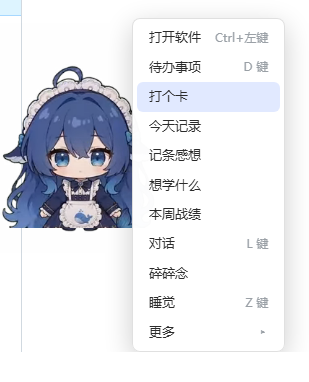
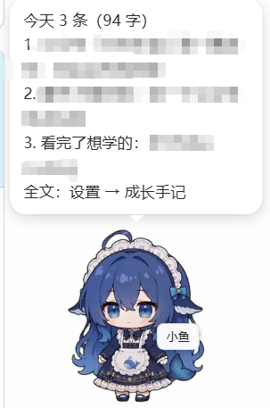
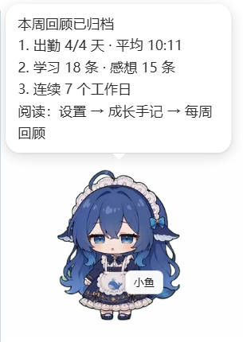
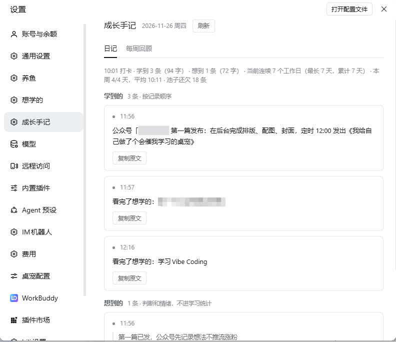
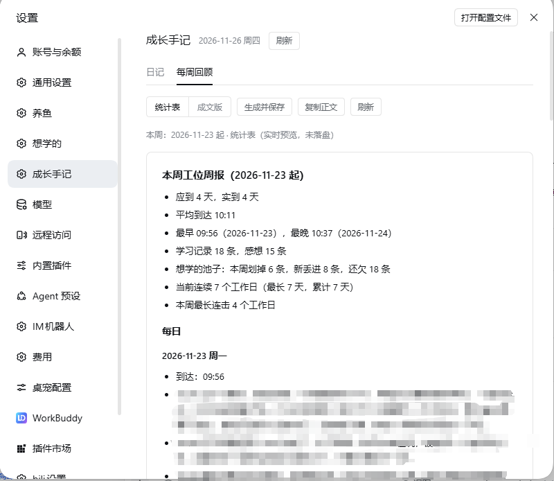
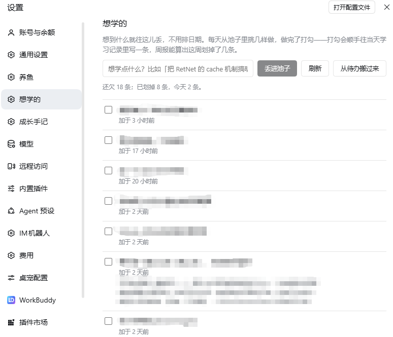

<p align="center">
  
</p>

<h1 align="center">dsh-gongwei · 工位打卡</h1>

<p align="center">
每天几点到工位、今天学了什么、心里在想什么 —— 记下来，周末自动长成一份周报。
</p>

<p align="center">
  <a href="docs/DETAIL.md">详细文档</a> ·
  <a href="#安装">安装</a> ·
  <a href="#五种用法">用法</a> ·
  <a href="#想学的池子">想学的池子</a> ·
  <a href="#配置">配置</a>
</p>

---

## 这是什么

一个给坐班生活用的 [DSH](https://github.com/deepseek-ai) 插件。它不试图管你学得好不好，只做四件事：

1. **记录到工位的时间**，并且和你自己的历史比——不是和「别人九点上班」比；
2. **每天催你写一句**今天学了什么、想了什么，写下的东西长期保存；
3. **收着「想学的」池子**：想到什么丢进去，做完了打勾，不用先排日期；
4. **每周自己长出一份周报**：一份统计表给自己复盘，一份散文体稿子可以直接发出去。

如果你也在读研、坐班、或者正想把「记录」这件事捡回来，它可能适合你。

## 长什么样

<p align="center">
  
</p>

<p align="center"><sub>右键小鱼，待办事项下面就是它那几项，不用进「更多」。</sub></p>

打卡之后它会念一句；记录多了会自动压成编号摘要，末尾指路成长手记：

| 点「今天记录」 | 点「本周战绩」 |
| :---: | :---: |
|  |  |

设置页里两个面板，一个每日日记、一个每周回顾：

| 成长手记 · 日记 | 成长手记 · 每周回顾 |
| :---: | :---: |
|  |  |

「想学的」是待办之外的素材库，不排期、不打岔：

<p align="center">
  
</p>

> 截图里的个人记录都做了打码处理。

## 为什么做这个

起因很简单：我知道记录有用，但我不会每天主动打开笔记软件。而桌宠一直待在我的屏幕上——把入口放在那里，比多一个需要想起的 App 更容易活下来。

所以设计上刻意做了几个取舍：

- **入口贴着注意力走**：桌宠右键菜单、`/gongwei` 命令、直接对话、设置页面板，四条路写同一份数据。你不需要"决定去记录"，你只是点了一下那个已经在你眼前的宠物。
- **打不打卡不影响数据**：播报失败（宠物睡着了、被别的窗口挡住）静默跳过，数据照常落盘。仪式感可以失效，记录不能丢。
- **两种东西分开存**：`学习记录` 是你做过的事实，`感想` 是你的判断和情绪。混在一个列表里，周报既不像复盘也不像随笔。
- **不假装有历史**：第一次打卡时只有基准线可比，文案就会直说「今天是基准线第一次生效」，而不是编一个「比以往早了」。
- **错过也能补**：周报不是「周五 21:45 那一刻必须开着应用」才生成，而是每次心跳问「最近一次该交的时刻是什么时候、交过了没有」。

## 功能

| 能力 | 说明 |
| --- | --- |
| 打卡 | 记录到达时刻，同时和**固定基准线**（默认 09:00）与**最近 10 个工作日平均**两个口径比，早晚都各自说一句话 |
| 每日记录 | 工作日 21:30（可改）提醒写「今天学了什么」；记录时若还没打卡会顺手补上 |
| 感想独立通道 | 与学习记录分开存，原样进周报的「想到的」一节 |
| 周报 | 每周五 21:45（可改）生成两份：`week-YYYY-MM-DD.md` 统计表、`week-YYYY-MM-DD-article.md` 公众号成文版 |
| 连续出勤 | 当前连续、历史最长、累计三个数；周末跳过不打断；**今天还没打卡时不算断** |
| 想学的池子 | 想到什么丢进去，不排日期；打勾即「做完了」，顺手往当天学习记录写一条，周报能算完成率。桌宠菜单 / `/gongwei` / 对话 / 设置页面板四条入口 |
| 持久记忆 | 每天的最新状态进入对话上下文，直接问「我这周怎么样」就能答，不需要复述 |
| 桌宠也知道 | 同一份摘要挂到 dsh-pet 的对话记忆槽，跟宠物聊天时它也知道你今天几点到、学了什么 |
| 长内容摘要 | 「今天记录」气泡不是把原文硬塞进去，而是每条压成一句人话（模型压缩 + 编号对齐 + 失败降级），截断按句读切；全文在设置页「成长手记」 |

## 安装

### 先弄清三件事

如果你从没用过 DSH，先花一分钟看这三行，后面会顺很多：

| 概念 | 是什么 | 你需要做的 |
| --- | --- | --- |
| **DSH**（DeepSeek Harness） | 跑助手的那个应用。本插件是它的扩展，不是独立软件 | 先装好 DSH 并能正常对话 |
| **bundle（插件包）** | 一个目录，里面有 `package.json` 和 `cordis.patch.yml`。DSH 认出这个结构就会加载它 | 把这个仓库下载到本地某个目录 |
| **dsh-pet**（可选） | 桌面宠物插件。本插件的右键菜单、气泡、语音都靠它 | 想要桌宠体验才装；不装也能用 |

所以整体只有两步：**把目录放到磁盘上 → 告诉 DSH 装它**。

### 第 1 步：下载到本地

推荐放在纯英文、无空格的路径里（例如 `E:\DSH\plugins\dsh-gongwei`）。路径里有中文或空格时，个别工具链会出问题。

```powershell
# 有 git
git clone https://github.com/RonaWhite/dsh-gongwei.git E:\DSH\plugins\dsh-gongwei
```

没有 git 也行：在 GitHub 仓库页面点 **Code → Download ZIP**，解压到 `E:\DSH\plugins\dsh-gongwei`。

> ⚠️ 解压后请确认：打开这个目录就能**直接看到** `package.json`。如果看到的是又一层 `dsh-gongwei-main` 文件夹，说明多套了一层，把里层的内容挪上来。

### 第 2 步：让 DSH 安装这个目录

有两种方式，任选其一：

1. **在 DSH 里装**：打开 DSH 的插件管理页面 → 安装本地 bundle / 本地目录 → 选中上面那个文件夹。
2. **让助手装**：在对话里直接说「把 `E:\DSH\plugins\dsh-gongwei` 装成插件」。

装好后插件列表里会出现 **「工位打卡」**，状态是启用。DSH 是**热加载**的，不用重启应用。

### 第 3 步：确认它真的在工作

按顺序试这三条，任何一条有反应就说明装成功了：

```text
/gongwei 状态          ← 斜杠命令，最不依赖其他东西
```

```text
跟我说：打个卡
```

- 右键桌宠 → 应该在「待办事项」下面看到 **打个卡 / 今天记录 / 记条感想 / 想学什么 / 本周战绩**（如果它们挤在「更多」里，见[可选：把菜单项提到第一层](#可选把菜单项提到第一层)）
- 打开设置 → **想学的** 和 **成长手记** 两个面板；网页端如果没看到，刷新一下页面

### 没有桌宠也能用

[dsh-pet](https://www.npmjs.com/package/dsh-pet) 是**可选**的。没装它时，下面这些入口照常工作，只是没有气泡和右键菜单：

- `/gongwei` 斜杠命令（打卡 / 记 / 感想 / 想学 / 池子 / 状态 / 周报 / 公众号）
- 直接跟助手说话（「打个卡」「记一下：今天看了 XXX」「这周怎么样」）
- 设置页的「想学的」「成长手记」面板

### 升级

```powershell
cd E:\DSH\plugins\dsh-gongwei
git pull
```

然后在插件管理里把它**禁用再启用**一次（或在对话里说「重载 gongwei 插件」），新代码才会进到正在运行的进程里。你的数据在 `$DSH_HOME/dsh-gongwei/`，升级不会动它。

## 五种用法

| 入口 | 怎么做 |
| --- | --- |
| 桌宠右键 | 右键宠物 → **对话**（已挪到「碎碎念」前）/ 待办事项 / 打个卡 / 今天记录 / 记条感想 / **想学什么** / 本周战绩。点「打个卡」会用克隆音色念一句按当天情况变化的问候 |
| 斜杠命令 | `/gongwei 打卡`、`/gongwei 记 今天看完了 LoRA 那篇`、`/gongwei 感想 方向还没定下来`、`/gongwei 想学 把 RetNet 的 cache 搞明白`、`/gongwei 池子`、`/gongwei 完了 1`、`/gongwei 撤销 1`、`/gongwei 状态`、`/gongwei 周报`、`/gongwei 公众号`、`/gongwei 搬`（从桌宠待办导入） |
| 设置页 | DSH 设置 → **想学的**：能直接敲、直接勾、改正文、加备注、两步确认删除 |
| 直接对话 | 「打个卡」「记一下：今天跑通了 xx」「感想：这周有点浮躁」「我想学 Chroma 的检索参数」「这个看完了」「池子里还剩什么」「这周我怎么样」「出个公众号版周报」 |
| 工具调用 | 模型会调 `gongwei` 工具，`action` 取 `checkin / log / think / status / week / config / plan_add / plan_list / plan_today / plan_done / plan_undo / plan_drop / plan_note / plan_import` |

五种入口写的是同一份数据，用哪个都行。

命令的动词和正文之间，**冒号（全角 `：` / 半角 `:`）、逗号、顿号、空格都行**，前面带「我想学」「帮我记」这类口头主语会被自动去掉。下面这些等价：

```text
/gongwei 想学：把 RetNet 的 cache 搞明白
/gongwei 想学:把 RetNet 的 cache 搞明白
/gongwei 我想学 把 RetNet 的 cache 搞明白
/gongwei 添加 把 RetNet 的 cache 搞明白
```

每个动词都有别名（`池子`=`清单`、`完了`=`划掉`…），**认不出来的动词直接报错**，不会静默变成别的动作。

**但它们的动作能力不一样**：桌宠菜单只能"回执"——点「今天记录」它把今天记过的东西压成摘要念给你听，点「本周战绩」它把本周概览念出来并顺手落盘两份周报，点「想学什么」它把池子里最上面三条念出来。真正写字得在对话里（`记一下：…` 或 `/gongwei 记 …`），或者在设置页的「想学的」面板里直接敲——因为桌宠的气泡没有输入框，dsh-pet 也没有提供往输入框预填文字的接口。

气泡装不下原文，所以做成了三层：

| 层 | 内容 | 为什么 |
| --- | --- | --- |
| 气泡 | 标题 + 换行编号 `1.`、`2.`，末尾指向「成长手记」 | 插件以 120 字符为摘要预算，最多展示三条；不是宿主硬限制。换行样式由可恢复的本地补丁提供 |
| 模型摘要 | 请求模型将每条压成约 24 字的短句，按编号对齐，遗漏逐条降级 | 摘要可能不完美，不改写原文 |
| 设置页「成长手记」 | 日记按段落阅读、支持常用 Markdown、展开原文和复制；每周回顾内读统计版和成文版，并可生成归档 | 气泡看一眼，全文在这里读；普通口语只自动分段，不冒充润色后的原作 |

摘要的两个关键设计：

- **写入时就预热**。每次 `记` / `感想` 落盘后后台就悄悄算一次进缓存，DSH 启动时也会把当天已有内容预热一遍。点菜单通常直接命中缓存，**一次气泡、0.5 秒内**出来，不用当场等模型十几秒。
- **冷启动分两步弹**。万一预热还没跑完就点了，先弹启发式首句，模型好了再默默覆盖一次（内容没变则不弹，避免闪烁）。宁可先粗糙，也不让人对着空气等。

唯一例外是「打个卡」：它会用你的克隆音色（`clone/custom`）念一句**每天不一样**的问候，固定两行——

- **第一行是「到了」**：`10:09 到，比平常晚一点，来了就算数。连续第 6 个工作日。` 早/晚/差不多各有 3 种说法按天轮换，连续天数逢 5 的倍数会换一句「这条线还没断」。
- **第二行是「钩子」**：优先挑**你昨天自己写过的话**问一句，比如 `昨天你提到「看完视频要尽早实操」，今天要不要先动它？`；昨天没写东西就引池子（`池子里还欠 18 条，今天挑一条？`）或本周进度（`这周已经到 3/3 天。`）；都没有就只留第一行——宁可短，也不凑字。

挑句子是打分制的：有「打算/先把/要…」这类行动词加分，动作动词开头加分，**带引号减分**（那多半是在复述别人的话，拎出来问会莫名其妙），「觉得/感觉/可能」减分。重复打卡还是一行「今天已经打过卡啦，别贪心，去忙吧～」。

实现是 `sayWithVoice()` 往 `/broadcast` 带 `surface=desktop` + `speak:true`，合成失败（如 CosyVoice2 余额不足）自动回退成普通气泡，话不会丢。气泡与语音共用同一份文本，所以钩子控制在 24 字以内。**只有打卡出声**，其余菜单项照旧只弹气泡。

## 想学的池子

这一块是「想到什么规划什么」用的，跟待办事项刻意做了区分：

- **不排期**。没有截止时间，它不是待办，是素材库。真正决定「今天做哪个」的是你自己，插件不替你排。
- **打勾即记录**。标成做完了，会顺手往当天的学习记录里写一条「看完了想学的：…」，还没打卡的话连打卡一起补上。撤销打勾会把那条记录**精确收回**（按写入时记的 `planLogTs` 匹配，不按文字——同一个说法你可能自己记过）。
- **周报算得进去**。统计版多一行「本周划掉 N 条，新丢进 M 条，还欠 K 条」，并列出本周划掉的；成文版不重复列（划掉时已经进了当天记录，再列一遍是废话）。
- **和桌宠待办自动对齐**。桌宠「待办事项」里**没设截止时间的原生条目，会自动收进池子并补上 `[想学]` 标记**——用你自己的口径区分：带截止=限期交作业，留在待办当任务不动；不带截止=想学，进池子。这样你在哪边写都能对得上，不用手动加前缀。想关掉这个自动收编见下方 `adoptUntimedTodos`。
- **从旧待办搬一次**。历史条目也可以一次性导入：设置页「从待办搬过来」按钮或 `/gongwei 搬`，已完成的保持已完成状态。搬完不删原待办，删不删是你的决定。

```jsonc
// state.json 里多出来的那段
"plans": [
  {
    "id": "p3-mwlthkaj",
    "text": "把 RetNet 的 cache 机制搞明白",
    "note": "先看第三章",          // 备注，可空
    "source": "chat",              // chat / panel / pet-todo
    "done": false,
    "createdAt": 1794000000000,
    "doneAt": null,
    "doneDay": null,               // 划掉那天，YYYY-MM-DD
    "planLogTs": null              // 自动写的那条学习记录的 ts，撤销靠它精确删除
  }
]
```

## 配置

改配置文件里 `config` 段，或者直接对助手说「把打卡基准改成 08:30」，它调工具改：

```jsonc
{
  "reminderTime": "21:30",  // 每日记录提醒时间
  "baseline": "09:00",      // 打卡基准线
  "weeklyDay": 5,           // 周报日，1=周一 … 7=周日
  "weeklyTime": "21:45",    // 周报生成时间
  "petId": "",              // 留空自动发现桌宠
  "adoptUntimedTodos": true // 桌宠待办里没设截止时间的原生条目，自动收进「想学的」池子并补 [想学] 标记；
                            // 带截止时间是限期任务，留在待办当任务不动。设 false 退回老行为
}
```

## 数据

全部是一个人类可读的 JSON，可以备份、手改、拿去做别的分析：

```
$DSH_HOME/dsh-gongwei/
  state.json                          # 全部打卡、记录、感想、想学的池子
  reports/week-YYYY-MM-DD.md          # 统计表周报
  reports/week-YYYY-MM-DD-article.md  # 公众号成文版
```

每天一条：

```jsonc
{
  "checkin": "09:12",                                                   // 到达时刻
  "checkinTs": 1794970183258,
  "entries":  [{ "at": "14:30", "ts": 0, "text": "跑通了 baseline" }],   // 学习记录
  "thoughts": [{ "at": "22:10", "ts": 0, "text": "方向还没定下来" }]     // 感想
}
```

池子在 `state.json` 顶层的 `plans` 数组里，结构见[想学的池子](#想学的池子)。

数据目录默认跟着 `DSH_HOME`；想放别的盘，设环境变量 `GONGWEI_DATA_DIR`。

## 周报长什么样

统计表那份是给自己看的：应到/实到、平均到达、最早最晚、本周最长连击，然后按天列出记录与感想。

成文版是给公众号的，第一人称、段落叙述：

```markdown
# 这周在工位的 4 天

这一周应到 5 天，我在工位坐了 4 天，平均 09:12 到。这个时间还算体面，至少是在
上午把自己按到椅子上。最早是周二的 08:48，最晚是周五的 09:51。

## 学到的

**周一**

- 把 baseline 跑通了，dev 集 F1 比上周高 1.3
- 读了一篇 episodic memory 的综述

**周二**

- 复现了对手的实现，差异出在 tokenizer 上

## 想到的

> 我一直在纠结用哪种记忆结构，但真正卡住的是我还没想清楚「要记住什么」。
>
> ——周三

## 下周

连续 3 天了，下周最要紧的是别把这个数断掉——哪怕只来半天，也打个卡。
```

它是**草稿**，不是成品：结构、事实、语气都摆好了，要不要发、想怎么改，还是你的事。

## 设计上的几个刻意选择

**为什么「今天没打卡」不算断**
早上九点还没打卡，不代表连续记录结束了。断点只由**已经过去**的工作日产生。所以上午查状态会看到「上段连续 5 个工作日」，下午打完卡就变成「连续第 6 个工作日」。

**为什么用「最近一次该交的时刻」而不是「现在到点了没」**
只在正点触发的话，那一刻你没开着电脑，那一周就永久没了。改成回头找最近一个已过的周期并和已交记录比对，最多回溯一周；首次安装不补发，免得刚装上就收到一份上周的空周报。

**为什么不改成「和全办公室平均比」**
你唯一值得比的对象是你自己的历史。基准线只是起步时的临时参照，攒够 10 个工作日之后就退到次要位置了。

## 已知边界

- 只在工作日统计。周末的打卡会记下来，但不计入应到天数，也不打断连续。
- 连续天数按「有打卡的工作日」数，不区分早晚——来了就算。
- 「平均」取最近 10 个有打卡的工作日；样本不足时只报基准线，并且明说。
- 桌宠睡着时宿主会拦掉气泡，但数据照常写入。
- 每日提醒**一天只发一次**（同一分钟内的心跳会去重）。
- 气泡有长度上限（插件自己定的 **120 字符**，宿主不限长），长内容会先被压成摘要；原文永远完整地留在数据文件、设置页「成长手记」和周报里。
- 成文版周报是模板生成的草稿，没有调用任何模型——所以它是免费的，也不需要联网。
- 池子的「撤销」只收得回插件自己写的那条记录（按 `planLogTs` 匹配）。从桌宠待办导入的历史条目没有 `planLogTs`，撤销时不会去动学习记录。
- 池子和桌宠待办是**两份独立数据**。导入是一次性搬迁，不是双向同步——之后在哪边改动都不会自动镜像到另一边。之所以不做同步：`dsh-pet` 的 `parseTodoRecord` 遇到任何不认识的字段就整条丢弃，硬塞自定义字段会把数据搞坏。
- 摘要要花一次模型调用（十几秒、几千 token 输入），所以做成写记录时预热 + 内容指纹缓存；内容很短的（总共 ≤60 字）不调模型，直接取首句。模型不可用时全程静默降级，不影响任何记录。

## 可选：把菜单项提到第一层

dsh-pet 没有向第三方插件暴露「菜单位置」的 API，第三方项默认只能落在右键菜单的「更多」里。如果你希望它们出现在第一层（待办事项下面）、并把「对话」从「更多」挪到「碎碎念」前面，可以用 `tools/patch-pet-menu.mjs` 给已安装的 dsh-pet 打一个本地补丁：

```bash
node tools/patch-pet-menu.mjs            # 打补丁（幂等）
node tools/patch-pet-menu.mjs --check    # 只看状态
node tools/patch-pet-menu.mjs --restore  # 还原
```

这一步**完全可选**，且属于本机定制：它改的是 `node_modules/dsh-pet/` 下的两个文件，**升级或重装 dsh-pet 会被覆盖**，届时重跑一次即可。细节见 [docs/DETAIL.md](docs/DETAIL.md)。

### 顺带：给原生待办事项加「改名 / 改到期」

用户更习惯直接在 dsh-pet 自带的「待办事项」里加东西，而它原生只能加/勾/删。另一个本地补丁 `tools/patch-pet-todo.mjs` 给每条待办加了 ✎（就地改名）和 ⏰（改到期时间）两个按钮，走 dsh-pet 已有的 `PATCH /todos/:id`，不动数据结构：

```bash
node tools/patch-pet-todo.mjs            # 打补丁（幂等）
node tools/patch-pet-todo.mjs --check    # 只看状态
node tools/patch-pet-todo.mjs --restore  # 还原
```

标记 `/* dsh-todo-edit v1 */`、备份 `.pre-todo.orig`，与上面的菜单补丁互不干扰，可共存。**升级 dsh-pet 会一起失效**，两个脚本各重跑一次：网页端刷新浏览器、桌面端 `POST /dsh-pet-7340/reload`。

### 顺带：让待办面板一次看到更多条

原生面板把清单高度写死成「行高 × 2」，十几条待办一次只露两行，往下翻很别扭。`tools/patch-pet-todo-tall.mjs` 做三件事：

- 行数 2 → 6，并按可视高度再夹一次（最少保留 2 行），高窗口多看、矮窗口不顶出屏幕；
- 「无期限」这类没信息量的副标题不再占行，只有带截止时间（或已完成）的才显示——大多数条目从两行变一行，同样高度能装的条目翻倍；
- 给清单加一条常驻的细滚动条，一眼看出「下面还有」；
- 顺带把正文里的 `[想学] ` 前缀渲染成一个小徽章，不再当文字占宽度。

```bash
node tools/patch-pet-todo-tall.mjs            # 打补丁（幂等）
node tools/patch-pet-todo-tall.mjs --check    # 只看状态
node tools/patch-pet-todo-tall.mjs --restore  # 还原
```

标记 `/* dsh-pet-todo-tall v1 */`、备份 `.pre-todotall.orig`。清单涨到 6 行仍在面板预留的高度预算内（`TODO_PANEL_METRICS` 取「清单+提示」与日历的较大值），所以桌宠窗口的上边距不用跟着改。

## 成长手记与编号气泡

设置页的 **成长手记** 是「读全文」的地方：日记页集中阅读当天的学习记录与感想（按段落排版、支持常用 Markdown、可展开原文、可复制），每周回顾页可以切换统计表 / 成文版、复制正文、生成并保存本周两份归档。预览不会写盘，原文也不会被气泡摘要改动。

桌宠的「本周战绩」显示分行概览（出勤 / 学习 / 连续），并在同一动作里把本周两份周报落盘，气泡指向这个阅读页，而不是弹一个不可点击的文件路径。

气泡里的换行依赖一个可恢复的本地样式补丁；升级 dsh-pet 后重跑一次，再重载桌宠并刷新网页（在插件目录里执行）：

```powershell
node tools/patch-pet-lines.mjs
```

## 常见问题 / 排错

**装完了，插件列表里没有「工位打卡」**
先看目录：选中的文件夹里必须能直接看到 `package.json`。多套一层 `xxx-main/` 是最常见的原因。其次是 DSH 版本过旧（本插件按 DSH 0.2.2 系列开发）。

**右键桌宠看不到「打个卡」这几项**
说明 dsh-pet 没装或没启用——这几项是 dsh-pet 的菜单。装了的话，它们默认应该就在「待办事项」下面；如果挤在「更多」里，是你的 dsh-pet 版本没打过菜单补丁，见[可选：把菜单项提到第一层](#可选把菜单项提到第一层)（那一步完全可选，不影响功能）。

**打卡有气泡但没声音**
出声是 dsh-pet 的功能，需要三步都满足：装了音色插件（配套的 `dsh-pet-voice-clone`，或任何注册了语音 provider 的插件）、桌宠设置里打开语音播报、音色选对。**注意本插件只有「打个卡」会出声**，其他菜单项只弹气泡（免得一天被念十几次）。合成失败（余额不足、网络）会静默降级成普通气泡，话不会丢。

**设置页找不到「成长手记」/「想学的」**
面板是客户端插件，改完要**刷新浏览器页面**。刷新后还没有，检查插件的 `webServer` 服务是否可用（其他插件抢占了同一路由时会失败）。

**周报没生成**
周报日是**周五 21:45**（可改成别的日子/时间）。错过那一刻也不会丢——插件每次心跳都会问「最近一次该交的时刻过了吗、交过没有」，下次打开 DSH 会补上。想立刻要一份，说「出个周报」或 `/gongwei 周报`。

**气泡里只有三条，我想看全部**
故意的。气泡的定位是「提示你有东西」，不是阅读器。全文在设置页「成长手记」，点两下就到。

**摘要要等十几秒 / 有时是原文首句**
摘要走一次模型调用。写完记录时插件就在后台预热并缓存，所以正常情况下点菜单是**立刻**出来的；冷启动（刚开 DSH 就点）会先弹启发式首句，模型好了再覆盖。模型不可用（没配、限流、超时）会一直用首句，功能不受影响。

**我的数据会被发到哪里**
只有「气泡摘要」这一步会把**当天那几条记录的文字**发给你在 DSH 里配置的模型。其余全部在本地：数据就是 `$DSH_HOME/dsh-gongwei/state.json` 一个文件。不想要摘要就不配模型，它会自动用启发式。

**换电脑 / 备份**
复制 `$DSH_HOME/dsh-gongwei/` 整个目录过去即可（`state.json` + `reports/`）。**不要在多台机器上同时写同一份**——它是单文件存储，没有同步机制，会互相覆盖。

**怎么卸载**
在插件管理里禁用或移除。数据不会自动删；想彻底清掉就手动删 `$DSH_HOME/dsh-gongwei/`。

**PowerShell 里看文件是乱码**
文件是 UTF-8，Windows PowerShell 5 默认按 GBK 解码中文。用 `Get-Content -Encoding UTF8` 或 VS Code 打开。

## 兼容性

- 核心功能只用到 DSH 的公开服务（`tools` / `commands` / `systemPrompt` / `webServer`），全部软依赖，缺了会静默降级。
- 设置页的「想学的」面板需要 `webServer`（注册 `/dsh-gongwei/api/plans`）和客户端 slot `settings.section`。没有 `webServer` 时面板不出现，但池子的其余入口（菜单 / 命令 / 对话）照常可用。
- 桌宠集成依赖 dsh-pet 的 HTTP 路由 `/dsh-pet-7340/*` 与 Cordis 服务 `petApi7340.memory`。前者是**未公开的内部接口**（dsh-pet 未提供插件 SDK 级的菜单 API），后者是它自带的内存槽注册表。两者随 dsh-pet 版本变化可能失效，失效时只有气泡、菜单和"宠物记得你"没了，数据与命令不受影响。
- 桌宠对话的记忆是**只读追加**：只往 system 末尾加一段工位摘要，不改人设、不改历史。
- 开发时对 `dsh-pet@0.4.9` / DSH 0.2.2 系列验证。

## 目录结构

```text
dsh-gongwei/
├── index.js              # 宿主侧全部逻辑：打卡、记录、池子、周报、工具、命令、HTTP API
├── im-notifier.mjs       # 可选的微信/IM 推送（配合 dsh-im；不用就不影响）
├── lib/client.js         # 设置页两个面板（React，运行在 DSH 客户端）
├── locale/{zh,en}.json   # 插件列表里显示的名字和介绍
├── icon.svg              # 插件图标
├── cordis.patch.yml      # 告诉 DSH「把我插进插件树」
├── docs/DETAIL.md        # 详细设计文档：口径、字段、边界、每个补丁改了什么
├── tools/                # 可选的 dsh-pet 本地补丁脚本（都有 --check / --restore）
├── smoke.mjs             # 300+ 项断言的全量自测，不需要真的 DSH
└── im-notifier.test.mjs  # IM 推送的单元测试
```

开发时常用：

```powershell
node smoke.mjs          # 全量自测（应该 300+ 项全绿）
node --check index.js   # 改完先看语法
```

`smoke.mjs` 用的是假 ctx + 临时目录，不会碰你的真实数据。

## 反馈与贡献

- 有 bug 或想法，开个 Issue 就好，附上你的 DSH / dsh-pet 版本、以及**报错时你做了什么**（菜单点的是哪一项）。别贴 `state.json` 原文，那里面有你的日记。
- 想改代码：这类插件的约定都写在 [docs/DETAIL.md](docs/DETAIL.md) 里；改动前先跑 `node smoke.mjs` 确认基线是绿的。
- 本插件依赖 dsh-pet 的**未公开内部接口**（`/dsh-pet-7340/*`、`petApi7340`）。如果 dsh-pet 改版导致失效，欢迎提 Issue——但请理解这属于上游接口变化，不一定能立刻跟上。

## License

MIT
